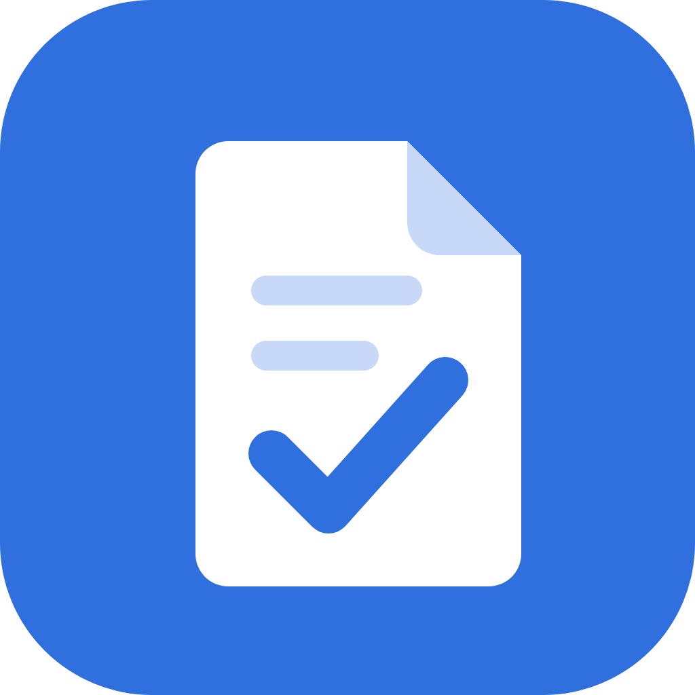
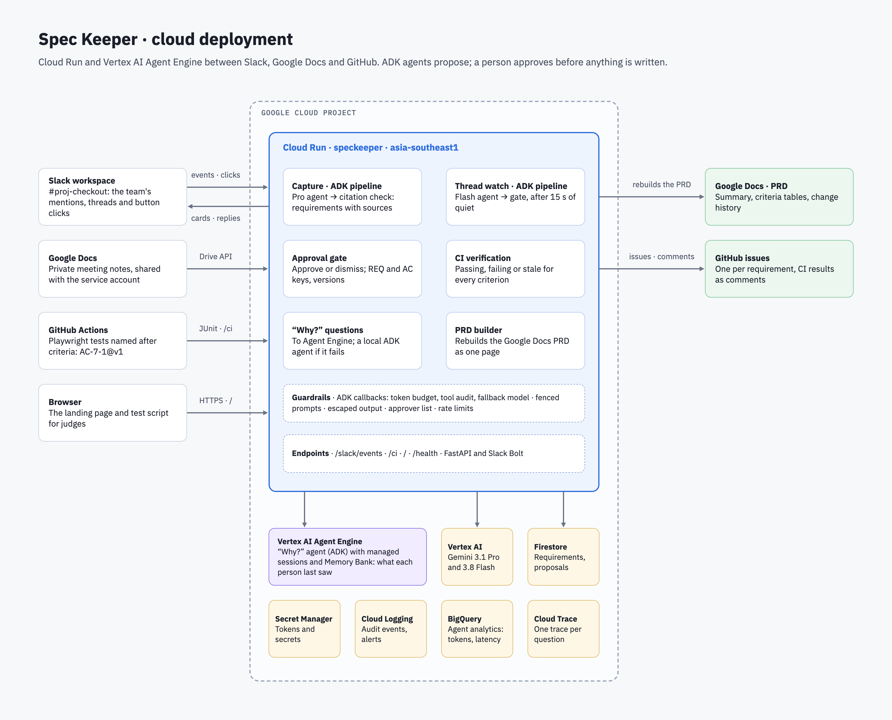
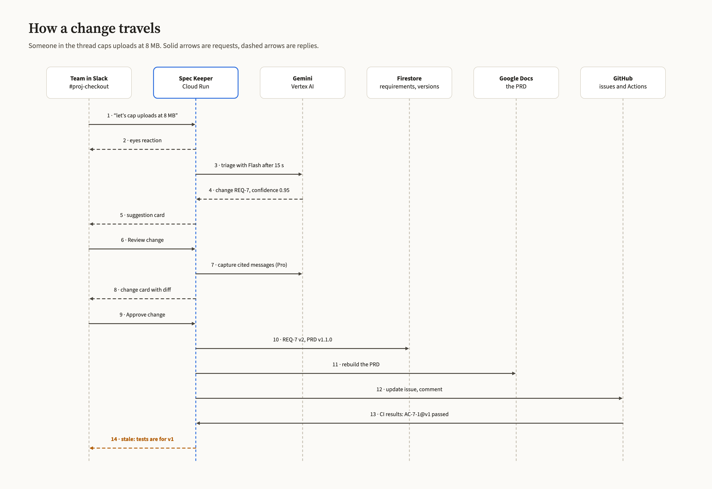
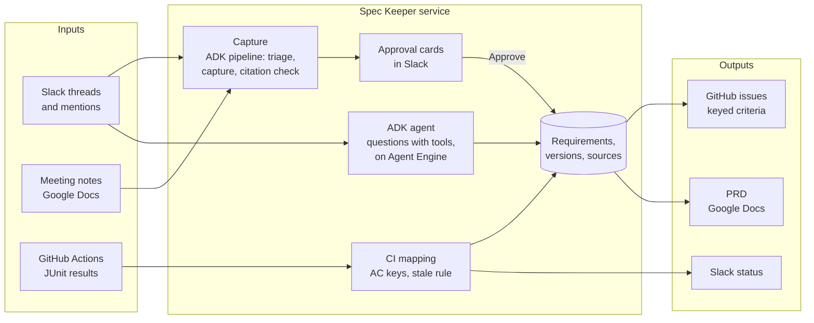

# Spec Keeper

**The Slack agent that makes sure what your team agreed on is what actually shipped.**

AI has made software teams faster, so requirements now change every few days. Decisions are made in
meetings and Slack threads, but the PRD, the acceptance criteria and the tickets are still updated by
hand, late or never, and a green CI run proves the tests pass, not that the agreed requirement
shipped.

Spec Keeper closes that loop. It captures requirements where they are agreed, cites where each one
came from, gets a person to approve them, keeps the PRD and GitHub issues in sync, and checks every
acceptance criterion against CI. When a later message changes an approved requirement, it catches
the change and flags the tests that still pass against the old text.

Built for the **AI Builder Cup 2026** (Future of Work & Enterprise Productivity) with Gemini on
Vertex AI and the Agent Development Kit.

▶ **[Watch the demo](https://www.youtube.com/watch?v=oDYUKIYXDic)** (4 min): Spec Keeper joins a live product,
keeps its spec, PRD and CI in step through the next initiative, and reports tests that prove an old PRD as stale.

## What it does

| Step | In Slack | What Spec Keeper does |
|---|---|---|
| **1. Capture a meeting** | `@Spec Keeper capture <link to the meeting notes>` | Reads the notes, extracts every agreed requirement with Gherkin acceptance criteria, cites the meeting time of each (`Checkout v2 kickoff, 00:06:45`), and keeps open questions out |
| **2. Approve** | **Approve all as v1.0.0**, or review one by one | Gives each requirement a key (`REQ-7`) and keyed criteria (`AC-7-1`), opens a GitHub issue for each, and records the PRD baseline v1.0.0. Nothing is written before a person clicks |
| **3. Verify in CI** | (automatic) | Tests named after a criterion (`AC-7-1@v1 shows the 25 MB limit`) report from GitHub Actions; Spec Keeper posts each criterion as passing or failing, and the requirement as verified only when all pass |
| **4. Catch a change** | `@Spec Keeper capture this` on a thread like "let's cap uploads at 10 MB" | Recognises that this changes REQ-7, shows the old and new criteria as a diff with both sources, and warns which tests are now **stale**. Approve makes REQ-7 v2 (PRD v1.1.0), never a second, contradicting requirement |
| **5. Stale, not green** | (automatic) | The next CI run still passes the old 25 MB test, and Spec Keeper reports it as stale, not verified, until the test is updated to `@v2` |
| **6. Retire a mistake** | `@Spec Keeper retire REQ-12 wrong notes`, or **Retire…** on an approved card | Asks an approver to confirm. A retired requirement leaves the PRD and CI and its GitHub issue is closed; its history and REQ number are kept, so "what happened to REQ-12?" still has an answer |
| **7. Plan the next initiative** | `@Spec Keeper prd Checkout v2 <doc link>`, then capture its kickoff notes | The kickoff is read against what's already approved: one card with its new requirements and its changes to shipped ones, approved as v2.0.0. Spec Keeper keeps the living product spec and a PRD per initiative, both from the same records, so they never disagree |
| **8. Ask why** | `@Spec Keeper why is the upload limit 10 MB?` | An ADK agent looks up the requirement, its change history and CI status, and answers with who decided, when, and links to the conversation. If the requirement changed since you last asked, it says so first |

## How it works



How one change travels through it, from a Slack message to a stale test:





**Design choices**

- **A person approves every write.** Capture only proposes; the PRD, issues and versions change on a
  click in Slack.
- **No citation, no requirement.** Gemini must cite the messages or meeting passages each requirement
  came from, and anything citing a source that wasn't in the input is dropped before a card is shown.
- **Fixed pipelines for extraction, an agent for questions.** Capture and thread watch are ADK
  `SequentialAgent` pipelines with strict JSON schemas: a Flash triage agent and a gate step, then a Pro
  capture agent and a citation-check step, where a fixed shape and the citation check matter most.
  Open-ended questions go to an ADK agent that chooses its tools (`list_requirements`, `get_requirement`,
  `get_history`), running on Vertex AI Agent Engine with Memory Bank.
- **Versions per requirement, and per criterion.** A change bumps REQ-7 to v2; each criterion keeps
  its key and takes the new version only if its text changed. Tests carry the version they were
  written for (`AC-7-1@v2`), which is what makes stale tests detectable.
- **Models:** Gemini 3.1 Pro for capture and Gemini 3.8 Flash for questions, on the Vertex AI global
  endpoint, each falling back to the other on a rate limit.

## Demo product

The demo product Spec Keeper watches is [taqelah/checkout-app](https://github.com/taqelah/checkout-app):
a receipt upload page whose Playwright tests are named after REQ-7's criteria, with a GitHub Actions
workflow that posts results to Spec Keeper.

## Security and data

Checked against the OWASP API, Web and LLM Top 10. In short:

- **Nothing is written without a person.** Gemini proposes; only a click on Approve changes the PRD or
  GitHub. Set `APPROVERS` (Slack user ids) to limit who can approve or dismiss.
- **Prompt injection.** Gemini's rules go in its system instruction; Slack messages and meeting notes go in
  the message as fenced, one-line data. Messages that give instructions or claim authority are never
  captured, and every requirement must cite a message that is really in the thread.
- **Output.** Text from people or Gemini is escaped before it reaches Slack (no `<!channel>` or crafted
  links) and @mentions in GitHub text are defused.
- **Channels.** `ALLOWED_CHANNELS` (names or ids) limits Spec Keeper to the project channels it's set up for.
  One store serves every channel, so elsewhere a mention gets a one-line reply, and clicks and thread messages
  do nothing.
- **Decisions.** Each proposal is claimed atomically (a Firestore transaction) before it is approved or
  dismissed, so a double click or two approvers can't file it twice. A change card records the version it
  was written against and is refused if the requirement changed or was retired since; requirements are
  saved with a compare-and-set, PRD versions are taken in a transaction, and the same notes are captured
  once at a time. Retiring needs an approver too. `reset demo` waits 10 minutes after someone else last
  used the demo, so it can't wipe a run in progress.
- **CI webhook.** The secret is checked before the body is read, the body is capped at 3 MB, and each
  result is posted in the thread where its requirement was last approved, never in a channel where no
  requirements were captured.
- **Requests.** Slack requests are signature-checked; `/ci` needs a shared secret and takes at most 2 MB of
  JUnit XML, parsed with `defusedxml`. Each user gets 50 Gemini requests (questions and captures) per 10
  minutes (`REQUESTS_PER_USER`), and is told privately when they can ask again; a daily token budget
  (`DAILY_TOKEN_BUDGET`) stops Gemini calls if it is reached. An empty notes doc is answered without
  calling Gemini. The question agent checks it before every
  model call and counts every call's tokens, through ADK callbacks.
- **Audit.** Approvals, dismissals, retirements, refused clicks, bad signatures and secrets, rate limits, the budget, every
  question-agent tool call (who asked, which tool and key, found or not) and model fallbacks are logged as structured entries in Cloud Logging, with an alert on repeated refusals.
- **Agent Engine.** The "why?" agent runs on Vertex AI Agent Engine (`deploy_agent.sh`) with managed sessions,
  called from Cloud Run (`AGENT_ENGINE`); the local agent answers if the engine fails. Its Memory Bank
  remembers which version of each requirement a person last saw (no message text), so an answer can start
  with what changed since they last asked.
- **ADK pipelines.** Capture and thread watch run as ADK multi-agent pipelines: a Flash triage agent and a
  gate step; a Pro capture agent and a citation-check step. A person's Review click sits between them.
- **Analytics.** Each question's events (Gemini calls with tokens and latency, tool calls) stream to
  BigQuery through ADK's analytics plugin, with a formatter that keeps counts and names and drops all text.
  Cost and latency queries are in [analytics/queries.sql](analytics/queries.sql).
- **Tracing.** Each question to the agent is a Cloud Trace trace (Gemini calls with tokens, tool calls,
  timings). Message text is kept out of spans (`ADK_CAPTURE_MESSAGE_CONTENT_IN_SPANS=false`).
- **Supply chain.** CI runs the tests and `pip-audit`; Dependabot watches dependencies and actions; actions
  are pinned to commit hashes.

**Data handling.** Spec Keeper reads only channels it is invited to, and only the threads it is mentioned
in. The text of those messages and of shared meeting notes, which may include people's names, is sent to
Gemini on Vertex AI in our Google Cloud project; Google does not use it to train models. Requirements,
their sources (message text, author id and link) and proposals are stored in Firestore in Singapore.
Logs record decisions and token counts, not message text. Secrets live in Secret Manager.

## Run it

Requirements: Python 3.12 with [uv](https://docs.astral.sh/uv/), a Slack app, and a Google Cloud
project with Vertex AI enabled.

```sh
uv sync
cp .env.example .env    # Slack token and signing secret, GCP project, GitHub token and repo, CI secret
gcloud auth application-default login
uv run --env-file .env uvicorn --factory speckeeper.main:app --port 8080
cloudflared tunnel --url http://localhost:8080    # a public URL for Slack and GitHub while running locally
```

**Slack app:** create it from [slack-manifest.yaml](slack-manifest.yaml), or by hand with bot scopes `app_mentions:read`, `chat:write`, `channels:history`, `channels:read`,
`groups:history`, `groups:read`, `reactions:write`, `users:read`; bot events `app_mention`, `message.channels`,
`message.groups`; Event Subscriptions and Interactivity request URL `<public URL>/slack/events`.
Invite the bot to the project channel, and set `ALLOWED_CHANNELS` to it (and `APPROVERS` to limit who
can approve).

**CI in the product repo:** start each test name with the criterion key and version
(`AC-7-1@v1 …`) and post the JUnit XML to `<public URL>/ci` with the header
`X-SpecKeeper-Secret` (see checkout-app's workflow).

**Deploy:** `GCP_PROJECT=... GITHUB_REPO=org/repo PRD_DOC_ID=... ./deploy.sh` (Cloud Run,
asia-southeast1, secrets from Secret Manager). `deploy.sh` sets every setting at once, so pass all the
ones you use each time (`ALLOWED_CHANNELS`, `APPROVERS`, `AGENT_ENGINE`, `REQUESTS_PER_USER`, …); one
left out is cleared. To answer questions on Agent Engine, run `GCP_PROJECT=... ./deploy_agent.sh` once,
then set `AGENT_ENGINE` to the name it prints and deploy again; after changing the agent, run it again
with `AGENT_ENGINE_ID` set. Both deploy scripts use your gcloud login, and `deploy_agent.sh` also your
application-default credentials, so both need access to the project.

## Test

```sh
uv run pytest
```

240 tests, about three seconds, no network. 83 of them run the whole app end to end: Slack-signed
events and button clicks through the real web app, with a local fake of the Slack API recording
everything Spec Keeper posts, plus negative cases (bad signatures, replayed requests, wrong CI secret,
broken CI XML, uncited output, rate limits) and corner cases. Others run two people at once: two
changes to one requirement, the same notes captured twice, simultaneous approvals.

## Evaluate the question agent

```sh
uv run --env-file .env --group eval python -m evals.qa.run
```

An ADK eval (`AgentEvaluator`) of the "why?" agent: 13 questions about a fixed project (the Checkout v2
kickoff, then the upload limit changed from 25 MB to 8 MB in Slack), each with the tool calls it needs
and a reference answer. A Gemini judge scores every answer. Latest results, 13 questions × 3 runs,
from Oct 15, 2026 ([evals/qa/report.json](evals/qa/report.json)):

| Metric | What it checks | Passed | Average |
|---|---|---|---|
| Tool trajectory (in order) | Called the right tools | 39 / 39 | 1.00 |
| Final response match v2 | Answer agrees with the reference | 39 / 39 | 1.00 |
| Hallucinations v1 | Every claim backed by a tool result | 39 / 39 | 0.995 |

It uses real Gemini, so it is run by hand, not in CI, and rarely: never in bulk, and never with
adversarial cases (see the limits in the results file below). `tests/test_evals.py` checks, without
Gemini, that every case can be answered from the fixture.

**Capture and thread watch,** from the runs made during development
([evals/development-results.md](evals/development-results.md)), on small hand-written cases:

| | Result |
|---|---|
| Capture precision (meeting notes → requirements) | 0.95 (20 / 21) |
| Capture recall | 1.00 (20 / 20); open questions captured: 0 / 8 |
| Thread watch: changes and new requirements caught | 10 / 10 |
| Thread watch: false alarms | 0 / 16 |
| Prompt-injection messages blocked | 3 / 3 |

**Cost:** a meeting capture costs about $0.05 in Gemini, a "why?" answer $0.006, a thread-watch check
$0.001, and one full demo about $0.09 ([evals/cost.md](evals/cost.md), from the token counts in Cloud Logging).

## For contributors

[AGENTS.md](AGENTS.md) has the rules, code map, data model, flows, testing approach and the pitfalls
we hit along the way.

## License

[Apache License 2.0](LICENSE).
