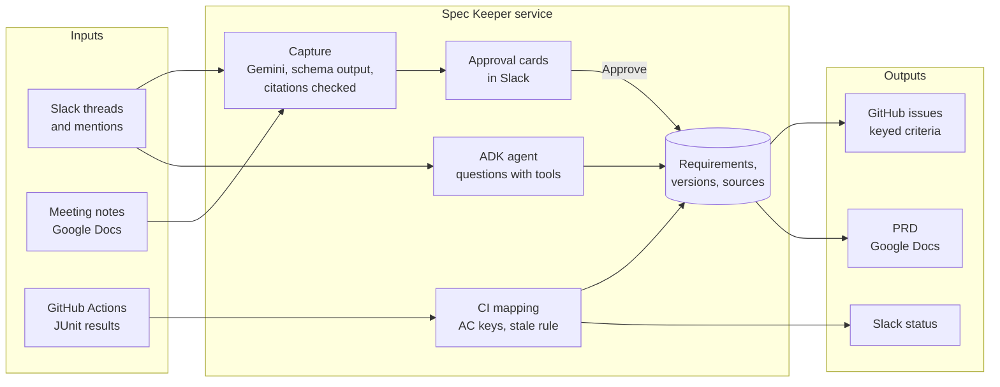

# Spec Keeper

**The Slack agent that makes sure what your team agreed on is what actually shipped.**

AI has made software teams faster, so requirements now change every few days. Decisions are made in
meetings and Slack threads, but the PRD, the acceptance criteria and the tickets are still updated by
hand, late or never, and a green CI run proves the tests pass, not that the agreed requirement
shipped.

Spec Keeper closes that loop. It captures requirements where they are agreed, cites where each one
came from, gets a person to approve them, keeps the PRD and GitHub issues in sync, and checks every
acceptance criterion against CI. When a later message changes an approved requirement, it catches
the change and flags the tests that still pass against the old text.

Built for the **AI Builder Cup 2026** (Future of Work & Enterprise Productivity) with Gemini on
Vertex AI and the Agent Development Kit.

## What it does

| Step | In Slack | What Spec Keeper does |
|---|---|---|
| **1. Capture a meeting** | `@Spec Keeper capture <link to the meeting notes>` | Reads the notes, extracts every agreed requirement with Gherkin acceptance criteria, cites the meeting time of each (`Checkout v2 kickoff, 00:06:45`), and keeps open questions out |
| **2. Approve** | **Approve all as v1.0.0**, or review one by one | Gives each requirement a key (`REQ-7`) and keyed criteria (`AC-7-1`), opens a GitHub issue for each, and records the PRD baseline v1.0.0. Nothing is written before a person clicks |
| **3. Verify in CI** | (automatic) | Tests named after a criterion (`AC-7-1@v1 shows the 25 MB limit`) report from GitHub Actions; Spec Keeper posts each criterion as passing or failing, and the requirement as verified only when all pass |
| **4. Catch a change** | `@Spec Keeper capture this` on a thread like "let's cap uploads at 10 MB" | Recognises that this changes REQ-7, shows the old and new criteria as a diff with both sources, and warns which tests are now **stale**. Approve makes REQ-7 v2 (PRD v1.1.0), never a second, contradicting requirement |
| **5. Stale, not green** | (automatic) | The next CI run still passes the old 25 MB test, and Spec Keeper reports it as stale, not verified, until the test is updated to `@v2` |
| **6. Ask why** | `@Spec Keeper why is the upload limit 10 MB?` | An ADK agent looks up the requirement, its change history and CI status, and answers with who decided, when, and links to the conversation |

## How it works



**Design choices**

- **A person approves every write.** Capture only proposes; the PRD, issues and versions change on a
  click in Slack.
- **No citation, no requirement.** Gemini must cite the messages or meeting passages each requirement
  came from, and anything citing a source that wasn't in the input is dropped before a card is shown.
- **Schema calls for extraction, an agent for questions.** Capture is one Gemini call with a strict
  JSON schema, where a fixed shape and the citation check matter most. Open-ended questions go to an
  ADK agent that chooses its tools (`list_requirements`, `get_requirement`, `get_history`).
- **Versions per requirement, and per criterion.** A change bumps REQ-7 to v2; each criterion keeps
  its key and takes the new version only if its text changed. Tests carry the version they were
  written for (`AC-7-1@v2`), which is what makes stale tests detectable.
- **Models:** Gemini 3.1 Pro for capture and Gemini 3.8 Flash for questions, on the Vertex AI global
  endpoint, each falling back to the other on a rate limit.

## Status

This is a hackathon prototype.

| Works today | In progress |
|---|---|
| Meeting and thread capture with citations | Writing the PRD into Google Docs (code done; needs the service account's access) |
| Approval cards, baseline v1.0.0 and minor versions | Deploy on Cloud Run with Firestore (`Dockerfile`, `deploy.sh` ready) |
| GitHub issues with keyed criteria | Drift detection on every channel message, not only on capture |
| CI verification per criterion, with stale tests | Measured results on labelled threads (eval suite) |
| Change detection: REQ-7 v1 to v2 with a diff | |
| ADK question agent with sources | |

The demo product Spec Keeper watches is [taqelah/checkout-app](https://github.com/taqelah/checkout-app):
a receipt upload page whose Playwright tests are named after REQ-7's criteria, with a GitHub Actions
workflow that posts results to Spec Keeper.

## Run it

Requirements: Python 3.12 with [uv](https://docs.astral.sh/uv/), a Slack app, and a Google Cloud
project with Vertex AI enabled.

```sh
uv sync
cp .env.example .env    # Slack token and signing secret, GCP project, GitHub token and repo, CI secret
gcloud auth application-default login
uv run --env-file .env uvicorn --factory speckeeper.main:app --port 8080
cloudflared tunnel --url http://localhost:8080    # a public URL for Slack and GitHub while running locally
```

**Slack app:** bot scopes `app_mentions:read`, `chat:write`, `channels:history`, `channels:read`,
`groups:history`, `groups:read`, `users:read`; bot events `app_mention`, `message.channels`,
`message.groups`; Event Subscriptions and Interactivity request URL `<public URL>/slack/events`.
Invite the bot to the project channel.

**CI in the product repo:** start each test name with the criterion key and version
(`AC-7-1@v1 …`) and post the JUnit XML to `<public URL>/ci` with the header
`X-SpecKeeper-Secret` (see checkout-app's workflow).

**Deploy:** `GCP_PROJECT=... GITHUB_REPO=org/repo PRD_DOC_ID=... ./deploy.sh` (Cloud Run,
asia-southeast1, secrets from Secret Manager).

## Test

```sh
uv run pytest
```

55 tests, about a second, no network. Thirty of them run the whole app end to end: Slack-signed
events and button clicks through the real web app, with a local fake of the Slack API recording
everything Spec Keeper posts, plus negative cases (bad signatures, replayed requests, wrong CI secret,
broken CI XML, uncited output, rate limits) and corner cases.

## For contributors

[AGENTS.md](AGENTS.md) has the rules, code map, data model, flows, testing approach and the pitfalls
we hit along the way.
